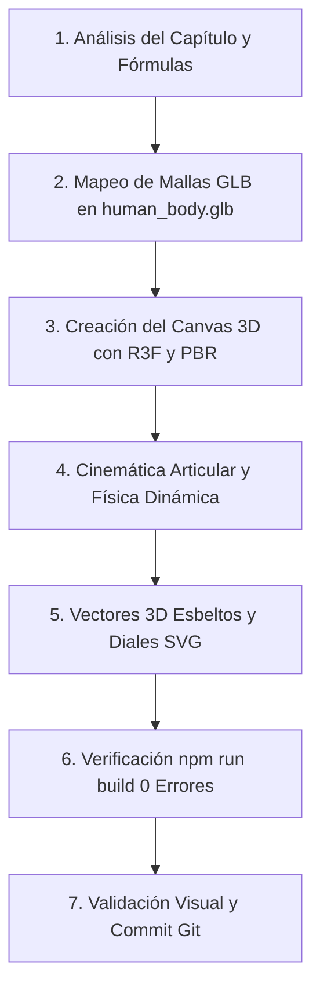

# 🏛️ ESTÁNDAR Y FLUJO DE TRABAJO PARA VISUALIZACIONES BIOMECÁNICAS 3D (CAPÍTULOS 3 AL 13)

> **Documento de Referencia Obligatoria para Agentes de IA y Desarrolladores.**  
> Este documento establece las normas arquitectónicas, estéticas, biomecánicas y de ejecución sistemática para implementar los capítulos restantes de la plataforma web *"La Física del Cuerpo Humano"*, garantizando el nivel de excelencia de grado médico y museo interactivo alcanzado en los Capítulos 1 y 2.

---

## 1. 🎯 Filosofía y Principios No Negociables

1. **Cero Versiones Primitivas o Esquemas 2D Planos**:
   - Si la articulación, hueso o fenómeno existe en el cuerpo humano, **se debe utilizar o construir una escena 3D en React Three Fiber (`@react-three/fiber` y `@react-three/drei`)** aprovechando las mallas anatómicas reales de BodyParts3D (`/assets/cap1/human_body.glb` y atlas musculares).
   - Los lienzos 2D HTML Canvas quedan reservados **únicamente** para planos psicofísicos de datos abstractos (ej. gráficas log-log de sensibilidad táctil) u oscilogramas CRT complementarios.
2. **Fidelidad Anatómica y Rigor Biofísico**:
   - Todos los cálculos biomecánicos (momentos de palanca, vectores de descomposición ortogonal, tensiones musculares $F_m$, presiones intradiscales en $\text{MPa}$, matrices de momentos de Varignon y fuerzas de reacción articular $R_j$) deben ser físicamente exactos y consistentes con la literatura médica (Nordin & Frankel, Kapandji, Dempster, Pauwels, Chaffin).
3. **Estética de Vanguardia (Medical Museum Grade)**:
   - Fondos cálidos de estudio anatómico con gradientes sutiles (`#ffffff` $\to$ `#faf6ee` $\to$ `#eee4d2`).
   - Materiales PBR con sombreado de marfil cálido periosteal, cartílago hialino ice-mint translúcido, vientres musculares estriados con emisión EMG activa y tendones nacarados.
   - HUDs flotantes *glassmorphism* no obstructivos con tipografía `JetBrains Mono` para valores numéricos y `Karla / Montserrat` para texto.
4. **Tolerancia Cero a Errores de Compilación**:
   - Cada entrega debe compilar de forma impecable con `npm run build` (`tsc -b && vite build`) arrojando **0 errores de TypeScript y 0 advertencias de Vite**.

---

## 2. 🦴 Catálogo de Mallas GLB Anatómicas Disponibles

Todos los modelos 3D se encuentran alojados en `webapp/public/assets/cap1/` y deben cargarse mediante `useGLTF`:

| Asset GLB | Ruta Relativa | Contenido Principal | Casos de Uso |
| :--- | :--- | :--- | :--- |
| **`human_body.glb`** | `/assets/cap1/human_body.glb` | **131 huesos anatómicos individuales** de BodyParts3D: Cráneo completo (`frontal`, `parietals`, `temporals`, `occipital`, `sphenoid`, `zygomatics`, `mandible`), columna vertebral (`cervical1..7`, `thoracic1..12`, `lumbar1..5`, `sacrum`), caja torácica, cintura escapular, miembros superiores e inferiores (`femur`, `patella`, `tibia`, `fibula`, `calcaneus`, `metatarsals`). | Esqueleto completo, articulaciones, cinemática ósea, palancas, tracciones y puntos de carga. |
| **`human_muscles_arm.glb`** | `/assets/cap1/human_muscles_arm.glb` | Músculos individuales del hombro, brazo, antebrazo y mano (`biceps_brachii_long/short`, `brachialis`, `triceps_brachii_long/lateral/medial`, `pronator_teres`, `coracobrachialis`, etc.). | Flexión/extensión del codo, supinación, prensión manual, palancas de 1ª y 3ª clase. |
| **`human_muscles_hip_leg.glb`** | `/assets/cap1/human_muscles_hip_leg.glb` | Músculos de la pelvis, cadera, muslo, pierna y pie (`gluteus_maximus/medius/minimus`, `quadriceps`, `hamstrings`, `gastrocnemius`, `soleus`, `tibialis_anterior`). | Apoyo monopodal de cadera, Trendelenburg, uso de bastón, sentadillas, marcha podálica. |
| **`human_muscles_trunk.glb`** | *(no se versiona — `webapp/assets_source/`)* | Músculos del cuello, masetero, dorso, erector espinal, recto abdominal, oblicuos y transverso. | Mordida ATM, tracción cervical, flexión/extensión lumbar, presión intradiscal. |
| **`human_muscles_full.glb`** | `/assets/cap1/human_muscles_full.glb` | Atlas muscular de cuerpo entero integrado con sistema locomotor completo. | Exploradores de cuerpo entero, síntesis biomecánica, mapas posturales globales. |

> **Espacio de coordenadas compartido (crítico)**:
> Los 5 GLB comparten **un solo sistema de coordenadas**: de pie sobre +Y, centrado
> en el origen, 1.0 unidades de alto. El esqueleto lo define; el resto se hornea
> con el transform canónico congelado en `webapp/scripts/bp3d_transform.json`
> (rotar −90° X → recentrar en el centroide del esqueleto → escalar a 1/altura).
> Consecuencia: los vientres musculares son **hermanos directos** de las mallas
> óseas — `<mesh geometry={muscleNodes.biceps_brachii_long_head_R.geometry} />`
> cae exactamente sobre el húmero **sin ninguna transformación en runtime**.
> Cualquier sistema nuevo (vísceras, nervios, vasos) se genera con
> `scripts/gen_bp3d_system.py` y hereda el mismo espacio.

> **Regla de Carga Óptima**:
> Pre-cargar siempre los assets en el pie del archivo del componente:
> ```tsx
> useGLTF.preload('/assets/cap1/human_body.glb');
> useGLTF.preload('/assets/cap1/human_muscles_arm.glb');
> ```

---

## 3. 🎨 Paleta de Materiales PBR y Shaders Estándar

Utilizar los siguientes `MeshStandardMaterial` para garantizar uniformidad visual en toda la aplicación:

```tsx
// 1. Hueso Cortical Marfil Periosteal (Grado Médico)
const boneMat = new THREE.MeshStandardMaterial({
  color: new THREE.Color('#ede5d0'),
  roughness: 0.55,
  metalness: 0.05,
});

// 2. Hueso de Contexto / Vértebras Base
const boneDeepMat = new THREE.MeshStandardMaterial({
  color: new THREE.Color('#ded3be'),
  roughness: 0.65,
  metalness: 0.05,
});

// 3. Cartílago Hialino / Discos Intervertebrales (Ice-Mint)
const cartilageMat = new THREE.MeshStandardMaterial({
  color: new THREE.Color('#68c5b8'),
  roughness: 0.28,
  metalness: 0.10,
  transparent: true,
  opacity: 0.88,
});

// 4. Músculo Estriado Activo con Emisión EMG
const activeMuscleMat = new THREE.MeshStandardMaterial({
  color: new THREE.Color('#b02318'),      // Carmín anatómico profundo
  emissive: new THREE.Color('#5a100a'),   // Brillo EMG bajo carga
  emissiveIntensity: 0.45,
  roughness: 0.40,
  metalness: 0.15,
});

// 5. Músculo Inactivo / Antagonista
const inactiveMuscleMat = new THREE.MeshStandardMaterial({
  color: new THREE.Color('#8c534b'),
  roughness: 0.60,
  metalness: 0.05,
});

// 6. Tendones Nacarados / Aponeurosis
const tendonMat = new THREE.MeshStandardMaterial({
  color: new THREE.Color('#f5f0e6'),
  roughness: 0.35,
  metalness: 0.20,
});

// 7. Raíz Nerviosa / Forámenes Descomprimidos
const nerveRelievedMat = new THREE.MeshStandardMaterial({
  color: new THREE.Color('#10b981'),      // Verde esmeralda (descomprimido)
  emissive: new THREE.Color('#059669'),
  emissiveIntensity: 0.70,
});
const nerveCompressedMat = new THREE.MeshStandardMaterial({
  color: new THREE.Color('#eab308'),      // Amarillo ámbar (comprimido)
  emissive: new THREE.Color('#d97706'),
  emissiveIntensity: 0.50,
});
```

---

## 4. 📐 Reglas de Oro para Vectores 3D (`ForceVector3D`)

El usuario y los auditores biomecánicos rechazan vectores gigantescos o desproporcionados que oculten la anatomía ósea. Seguir estrictamente estas proporciones:

```tsx
// Regla Proporcional Canónica para ForceVector3D:
const len = vector.length();

// 1. Longitud máxima acotada: ≤ 1/3 de la longitud del hueso sobre el que actúa
// 2. Vástago cilíndrico esbelto:
const shaftRadius = 0.008 - 0.011;

// 3. Cabeza cónica compacta:
const headLen = Math.min(0.045, Math.max(0.025, len * 0.22));
const headRadius = headLen * 0.35;

// 4. Badge HTML flotante (Frosted Glass):
<Html position={[tip.x, tip.y, tip.z]} center zIndexRange={[100, 0]}>
  <div style={{
    background: 'rgba(255, 255, 255, 0.95)',
    backdropFilter: 'blur(6px)',
    border: `1.2px solid ${color}`,
    borderRadius: '4px',
    padding: '2px 6px',
    boxShadow: `0 2px 8px ${color}25`,
    fontSize: '0.58rem',
    fontWeight: 700,
    fontFamily: 'JetBrains Mono, monospace',
    color: color,
    whiteSpace: 'nowrap',
    pointerEvents: 'none',
  }}>
    {label}
  </div>
</Html>
```

---

## 5. 🎛️ Arquitectura de Escena y Estudio de Luz

**Boilerplate oficial: `src/chapters/cap1/three/`.** No repitas `<Canvas>` + luces
+ `ContactShadows` + `OrbitControls` por escena — usa la fundación compartida:

```tsx
import { AnatomyStage } from './three/AnatomyStage';
import { useAnatomyNodes } from './three/useAnatomyNodes';
import { materials } from './three/materials';
import { useHarmonicClock } from './three/useHarmonicClock';

function MiCanvas({ resetSignal, zoomSignal }) {
  const nodes = useAnatomyNodes('body');            // GLB en espacio canónico
  return (
    <AnatomyStage
      camera={{ position: [x, y, z], fov: 42 }}
      target={[0, 0, 0]}
      resetSignal={resetSignal} zoomSignal={zoomSignal}
      fit fitPadding={1.6}                           // auto-encuadre opcional (ver nota)
    >
      <mesh geometry={nodes.humerus_R.geometry} material={materials.bone} />
      {/* ...anatomía... */}
    </AnatomyStage>
  );
}
```

- **`AnatomyStage`** encapsula: `<Canvas>` (dpr, gl), fondo de estudio (`STUDIO_BG`),
  rig de 3 luces estándar, `<ContactShadows>`, `<gridHelper>` opcional,
  `<AccessibleOrbitControls>` + `<SceneControlPad>`, y el ErrorBoundary +
  detector de WebGL con fallback. Señales `resetSignal` / `zoomSignal` ya
  cableadas. Props: `camera`, `target`, `minDistance/maxDistance/minPolarAngle/
  maxPolarAngle`, `grid/gridY/gridArgs`, `shadow/shadowY/shadowScale/shadowOpacity`,
  `autoRotate`, `fit/fitPadding/refit`, `overlay` (HTML superpuesto), `id`.
- **`materials`** = instancias PBR compartidas (`bone`, `boneContext`, `boneGhost`,
  `boneHighlight`, `cartilage`, `muscleActive`/`makeMuscleActive(i)`, `muscleIdle`,
  `muscleNeutral`, `tendon`). No mutarlas; `.clone()` si necesitas variar.
- **`useAnatomyNodes(pack)` / `useAnatomyScene(pack)`** — `pack` ∈ `body`,
  `muscles_arm`, `muscles_hip_leg`, `muscles_full`. Precarga el esqueleto sola.
- **`useHarmonicClock({ playing, speed }, tick, resetOn?)`** — un solo bucle rAF
  frame-rate independiente; reemplaza los `animTimeRef`/`animRafRef` por escena.
- **`<FitCamera>`** (o `fit` en `AnatomyStage`): encuadra los límites del contenido.
  ⚠ **NO uses `fit` si la escena tiene un plano anatómico grande** (`showPlanes`) o
  geometría auxiliar voluminosa: dominan el bounding box y empequeñecen el modelo.
  Ahí usa cámara fija.

<details><summary>Boilerplate manual anterior (solo si `AnatomyStage` no encaja)</summary>

```tsx
<Canvas
  shadows
  camera={{ position: [0.6, 0.4, 1.2], fov: 42 }}
  style={{ width: '100%', height: '100%', display: 'block' }}
  gl={{ antialias: true, powerPreference: 'high-performance' }}
>
  {/* 1. Fondo de estudio anatómico cálido */}
  <color attach="background" args={['#faf6ee']} />

  {/* 2. Iluminación de estudio médico de 3 puntos */}
  <ambientLight intensity={0.75} color="#fffcf5" />
  <directionalLight
    position={[2.5, 4.0, 3.0]}
    intensity={1.25}
    color="#fff8eb"
    castShadow
    shadow-mapSize={[1024, 1024]}
    shadow-bias={-0.0001}
  />
  <directionalLight position={[-2.0, 1.5, -2.0]} intensity={0.45} color="#e0f2fe" />
  <directionalLight position={[0, -2.0, 1.0]} intensity={0.20} color="#fef3c7" />

  {/* 3. Sombra de contacto en el piso */}
  <ContactShadows
    position={[0, -0.45, 0]}
    opacity={0.45}
    scale={3.0}
    blur={2.0}
    far={1.5}
    color="#232c36"
  />

  {/* 4. Controles de órbita con amortiguación suave */}
  <OrbitControls
    enableDamping={true}
    dampingFactor={0.06}
    minDistance={0.3}
    maxDistance={4.0}
    maxPolarAngle={Math.PI / 2 + 0.15}
  />

  {/* 5. Contenido Anatómico dentro de Suspense */}
  <Suspense fallback={null}>
    <AnatomicalModel {...props} />
  </Suspense>
</Canvas>
```

</details>

> ⚠️ **REGLA CRÍTICA DE DREI / R3F**:
> **NUNCA** envolver componentes de Drei como `<Center>`, `<OrbitControls>`, `<Html>`, `<Line>`, `<gridHelper>` o `<ContactShadows>` dentro de otros `<Center>`. Esto provoca errores de ciclo de render y pantallas blancas.

---

## 6. 📊 Instrumentación y HUDs (Diales SVG y Polígonos de Fuerza)

Acompañar siempre los modelos 3D con instrumentos analógicos de lectura rápida integrados:

1. **Manómetros y Diales Analógicos SVG**:
   - Rango de aguja de $-135^\circ$ a $+135^\circ$ con transición cúbica suave (`cubic-bezier(0.34, 1.56, 0.64, 1)`).
   - Tres sectores cromáticos: Verde (Fisiológico / Seguro), Ámbar (Sobrecarga / Esfuerzo), Rojo (Riesgo Crítico / Fallo Tisular).
   - Lectura digital central en `JetBrains Mono` con doble escala ($\text{N}$ y $\text{kgf}$, o $\text{MPa}$ y $\text{Bar}$).
2. **Polígono Vectorial Cerrado ($\Sigma\vec{F} = 0$, $\Sigma\vec{\tau} = 0$)**:
   - Tarjetas flotantes SVG que demuestren visualmente si los vectores forman un triángulo/polígono cerrado en equilibrio o si existe una brecha $\Delta\tau \neq 0$ que genera movimiento o inestabilidad.
3. **Presets Clínicos Inmediatos**:
   - Botones segmentados con estado activo resaltado (`var(--teal)` y fondo blanco con sombra) para alternar rápidamente entre escenarios patológicos y terapéuticos (ej. *Carga Ligera*, *Máxima*, *Postura Correcta*, *Patología / Deformidad*).

---

## 7. 🔄 Flujo de Trabajo Sistemático para Nuevos Capítulos (Capítulo 3 al 13)

Cualquier subagente o desarrollador debe ejecutar los siguientes **7 pasos secuenciales**:



### Paso 1: Análisis del Capítulo y Modelado Matemático
- Extraer las fórmulas fundamentales, parámetros ajustables (sliders) y casos clínicos del capítulo.

### Paso 2: Mapeo de Mallas Anatómicas
- Identificar en `human_body.glb` y atlas musculares los nombres exactos de los nodos óseos y musculares. Si una pieza requiere geometría especializada (ej. prótesis de titanio, tornillos de fijación, férulas, meniscos, agujas), modelarla proceduralmente con Three.js combinada con las mallas GLB.

### Paso 3: Construcción del Canvas 3D Base
- Crear el componente `[Nombre]Canvas.tsx` con el boilerplate estándar (Canvas, Luces 3-puntos, OrbitControls con damping, ContactShadows, Suspense).

### Paso 4: Implementación de la Cinemática y Deformación
- Programar la rotación, flexión/extensión o translación de los huesos usando `useFrame` o props directas de React.
- Incluir deformaciones tisulares vivas (abombamiento muscular con carga, apertura discal $\Delta h$, compresión de cartílago).

### Paso 5: Despliegue de Vectores y Diales
- Integrar `ForceVector3D` calibrados ($\le 1/3$ del hueso, vástago fino `0.008 - 0.011`).
- Añadir el dial analógico SVG y la tarjeta explicativa con fórmulas en KaTeX.

### Paso 6: Compilación de Prueba y Corrección de Tipos
- Ejecutar `npm run build` en `webapp/`. Resolver cualquier problema de tipado en TypeScript antes de continuar.

### Paso 7: Commit Registrado
- Registrar los cambios en git con formato semántico: `feat(capX): Implement 3D R3F visualization for slide X using authentic GLB meshes`.

---

## 8. 📋 Resumen de Nomenclatura Clave de Huesos en `human_body.glb`

```typescript
// Columna Vertebral
nodes.cervical1 .. nodes.cervical7
nodes.thoracic1 .. nodes.thoracic12
nodes.lumbar1 .. nodes.lumbar5
nodes.sacrum

// Cráneo y Cara
nodes.frontal, nodes.parietal_L, nodes.parietal_R, nodes.occipital, nodes.temporal_L, nodes.temporal_R
nodes.mandible, nodes.maxilla_L, nodes.maxilla_R, nodes.sphenoid, nodes.zygomatic_L, nodes.zygomatic_R

// Miembro Superior
nodes.clavicle_R, nodes.scapula_R, nodes.humerus_R, nodes.radius_R, nodes.ulna_R
nodes.scaphoid_R, nodes.lunate_R, nodes.triquetral_R, nodes.pisiform_R, nodes.trapezium_R, nodes.trapezoid_R, nodes.capitate_R, nodes.hamate_R
nodes.metacarpal_1_R .. nodes.metacarpal_5_R

// Miembro Inferior y Pelvis
nodes.hip_R, nodes.hip_L, nodes.femur_R, nodes.femur_L, nodes.patella_R, nodes.patella_L
nodes.tibia_R, nodes.tibia_L, nodes.fibula_R, nodes.fibula_L
nodes.talus_R, nodes.calcaneus_L (usar con escala invertida para R), nodes.navicular_R, nodes.cuboid_R
nodes.metatarsal1_R .. nodes.metatarsal5_R
```

---
*Fin del Estándar. Cualquier agente de IA que reciba la instrucción de trabajar en un nuevo capítulo debe leer este documento antes de comenzar.*
